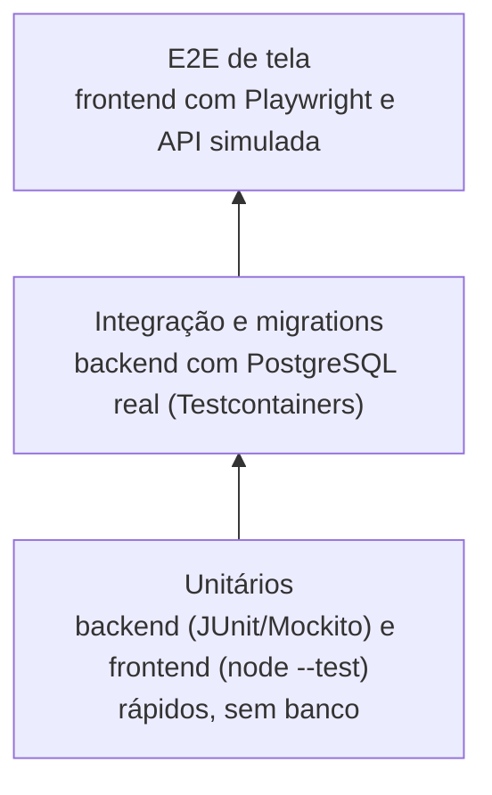

# Estratégia de Testes

Esta página descreve como o Inventarium é testado: quais camadas existem, que ferramenta cada uma usa, como rodar os testes localmente, onde eles rodam na CI e qual é a meta de cobertura. Os números e comandos foram conferidos no repositório em 2026-11-14.

## Visão Geral

| Camada | Onde fica | Ferramenta | O que valida | Banco de dados |
| --- | --- | --- | --- | --- |
| Unitário do backend | `backend/src/test/java` | JUnit 5, Mockito | Regras isoladas: geração de QR Code e PDF, envio de e-mail, CORS, filtros de observabilidade, conclusão de inventário. | Nenhum |
| E2E do backend (integração) | `backend/src/test/java`, classes `*E2ETest` | Spring Boot Test, `TestRestTemplate`, Testcontainers | A aplicação inteira por HTTP: autenticação, permissões, setores, salas, inventários, itens, importação de CSV e PDFs. | PostgreSQL 15 real, em container |
| Migrations do backend | `backend/src/test/java/clp/inventory/migration` | Spring Boot Test, Testcontainers | Que cada migration do Liquibase transforma os dados existentes como esperado. | PostgreSQL 15 real, em container |
| Unitário do frontend | `frontend/tests/unit` | `node --test` | Schemas de validação de formulário e formatação da versão do app exibida na tela. | Nenhum |
| E2E do frontend | `frontend/tests/e2e` | Playwright (Chromium) | Fluxos de tela: controle de acesso, administração, conclusão e filtros de inventário, salas, responsividade e importação de planilha. | Nenhum: a API é simulada |



A maior parte da confiança do backend vem dos testes E2E com banco real, que passam pela segurança, pelo controller, pelo service e pelo PostgreSQL. Os testes unitários ficam para o que não precisa do contexto do Spring (geração de PDF e QR Code, e-mail, configuração de CORS). No frontend, os testes de tela usam uma API simulada, então não provam a integração com o backend real.

## Backend

### Como é escrito

- Cada teste E2E sobe a aplicação com `@SpringBootTest(webEnvironment = RANDOM_PORT)` e um `PostgreSQLContainer` do Testcontainers, ligado por `@ServiceConnection`. O Liquibase roda de verdade no container, então o schema testado é o da aplicação.
- As requisições são HTTP reais por `TestRestTemplate`, com um JWT assinado com um segredo de teste (`security.token.secret`), como o filtro de segurança espera.
- `TestAccess` (`testsupport/`) monta usuários de teste: administrador, gestor, operador e consulta, com ou sem alocação em um setor. Use-o em vez de criar usuários à mão.
- Os testes ficam agrupados por domínio, em pacotes como `access`, `auth`, `inventory`, `itemaudit`, `permission`, `role`, `room`, `sector`, `security` e `migration`.
- Efeitos externos que não fazem parte do teste são trocados por mocks. O envio de e-mail, por exemplo, é um `@MockitoBean EmailService` nos testes de endpoint; o envio em si é testado em `EmailServiceTest`.

### Como rodar

```bash
cd backend
./gradlew test                       # roda tudo e gera o relatório de cobertura
./gradlew test --tests '*SectorE2ETest'   # uma classe
```

O Docker precisa estar ligado, por causa dos Testcontainers. A execução completa leva cerca de 1 minuto e meio. Em 2026-11-14 ela tinha 304 testes e nenhuma falha.

### Convenções para testes novos

- Todo endpoint novo ganha um teste E2E com o caminho de sucesso e os de erro previstos (por exemplo 400, 403 e 404). Os códigos esperados são os que o endpoint declara no Swagger.
- Nome do arquivo: `*E2ETest` para testes com a aplicação inteira e `*Test` para os unitários.
- Teste comportamento que o código realmente tem. Quando um teste revelar um comportamento estranho (por exemplo, um `PUT` em inventário inexistente responder 400), registre-o no teste com um comentário em vez de escondê-lo.
- Cada teste cria os próprios dados, com nomes únicos, para não depender da ordem de execução.

## Frontend

### Testes unitários

```bash
cd frontend
npm run test:unit        # node --test tests/unit/*.test.ts
```

Hoje são dois arquivos: `validations.test.ts` (schemas de e-mail, login e inventário) e `app-version.test.ts` (função `formatAppVersion`). Rodam direto no Node, sem navegador.

### Testes E2E

```bash
cd frontend
npx playwright install chromium   # só na primeira vez
npm run test:e2e                  # playwright test
```

São sete especificações em `tests/e2e`: `access-control`, `administration`, `inventory-completion`, `inventory-filters`, `responsive`, `rooms` e `spreadsheet`. O Playwright sobe o `next dev` sozinho em `127.0.0.1:3100` (com `PLAYWRIGHT_TEST=1`) e executa com um worker, em sequência. As chamadas à API são interceptadas com `page.route` e respondidas por dados simulados, então esses testes **não** sobem backend nem banco. Quando um teste falha, o Playwright guarda o trace (`retain-on-failure`); na CI ele é publicado como artefato.

## Cobertura de Testes

| Item | Valor |
| --- | --- |
| Métrica do gate | Cobertura de **linhas** do backend, medida pelo JaCoCo |
| Meta da Unidade 1 | Pelo menos 70% |
| Meta da Unidade 2 | Acima de 90% |
| Gate configurado | 80% de linhas (`jacocoTestCoverageVerification`, ligado ao `check` e executado na CI) |
| Cobertura medida em 2026-11-14 | **93,4%** das linhas (2.045 de 2.190); 83,0% dos branches |

Para medir localmente:

```bash
cd backend
./gradlew test jacocoTestCoverageVerification
# relatório navegável: backend/build/reports/jacoco/test/html/index.html
# relatório em XML:    backend/build/reports/jacoco/test/jacocoTestReport.xml
```

O build, e o check `Backend format and tests` da CI, falham quando a cobertura de linhas fica abaixo de 80%. O piso do gate (80%) é menor que a meta da Unidade 2 (acima de 90%): ele impede regressões grandes, mas a meta continua sendo perseguida acima dele. O relatório HTML mostra a cobertura por pacote e por classe e marca, no código, as linhas sem teste; é o ponto de partida para decidir onde escrever o próximo teste.

A métrica escolhida é a de linhas porque a de branches (83,0%) tem menos folga e oscila mais com mudanças pequenas. Código sem chamador não deve ser mantido só para existir: ele conta como cobertura perdida e deve ser removido.

## Onde os Testes Rodam na CI

Os testes rodam no workflow `Quality`, para PRs que alteram a respectiva aplicação. A [Esteira de CI/CD](./Esteira-de-CI-CD) detalha o gatilho de cada job.

| Job | O que executa |
| --- | --- |
| `Quality / Backend format and tests` | `./gradlew spotlessCheck` (informativo) e `./gradlew test` (bloqueante). |
| `Quality / Frontend spreadsheet tests` | `npm run test:unit` e, depois de instalar o Chromium, `npm run test:e2e`. Publica os traces do Playwright como artefato. |
| `Quality / Frontend lint` | `npm run lint` (ESLint), informativo. |

## O Que Ainda Não Existe

| Lacuna | Situação |
| --- | --- |
| Cobertura do frontend | Não há medição nem meta numérica para o frontend. Os 93,4% são do backend. |
| Badge de cobertura | Não há badge no README. |
| Integração frontend + backend | Os E2E do frontend usam API simulada e os do backend não passam pela interface. Nenhum teste automatizado exercita as duas pontas juntas. |
| Testes de segurança dinâmicos | A esteira tem análise estática (Semgrep, CodeQL) e scan de dependências e imagens (Trivy), mas não há teste dinâmico da API em execução. |
| Testes de carga | Não existem. |

## Histórico

| Versão | Data | Descrição |
| --- | --- | --- |
| 1.0 | 2026-11-14 | Criação da página de Estratégia de Testes com camadas, comandos, cobertura, execução na CI e lacunas. |
| 1.1 | 2026-11-17 | Gate de cobertura de linhas passa a rodar na CI, com piso de 80%. |
